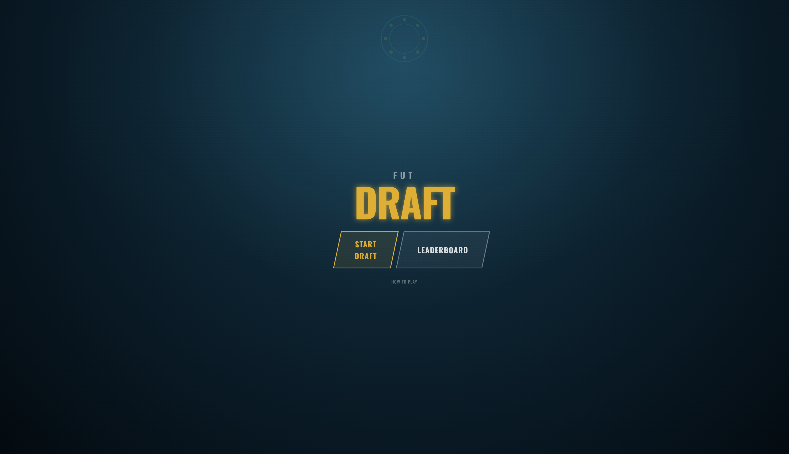
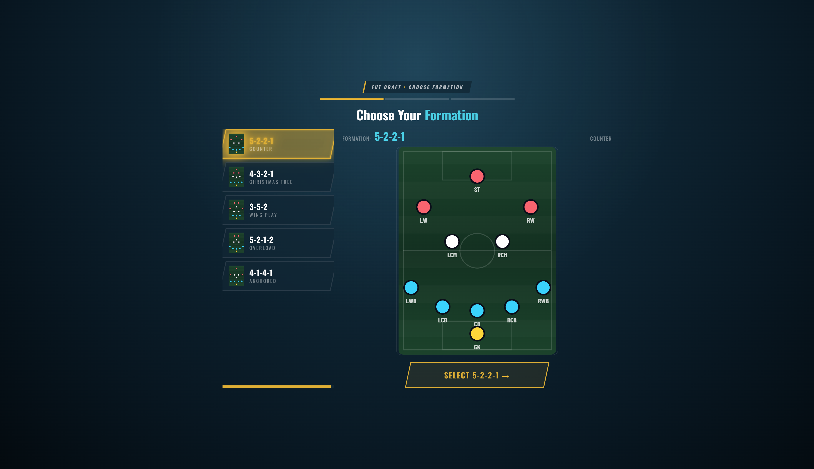
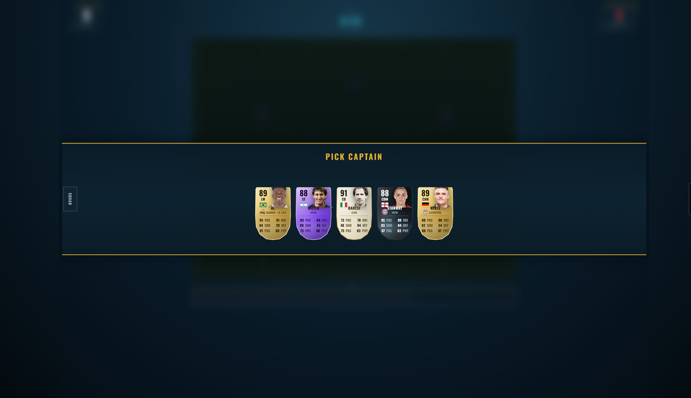
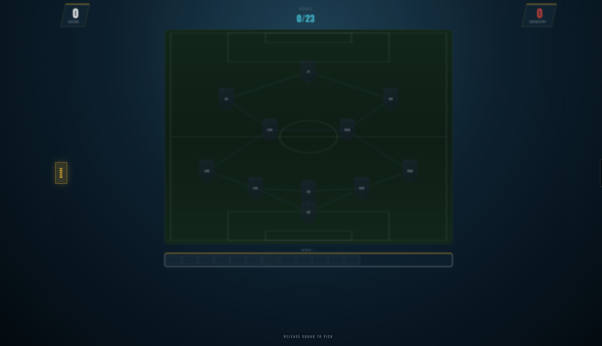
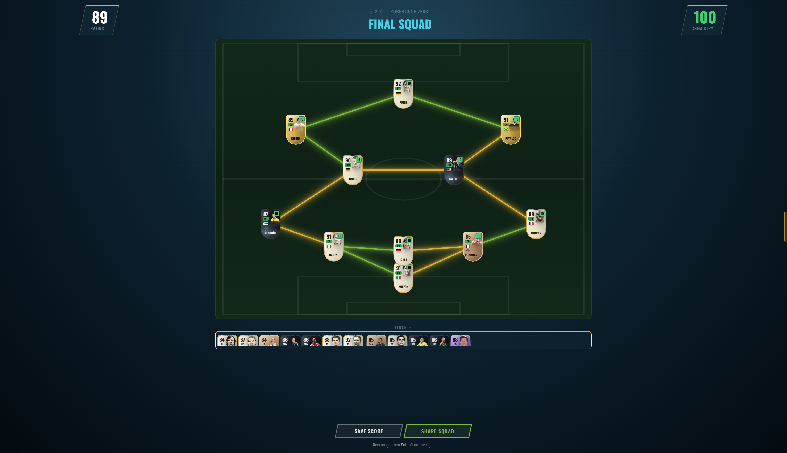
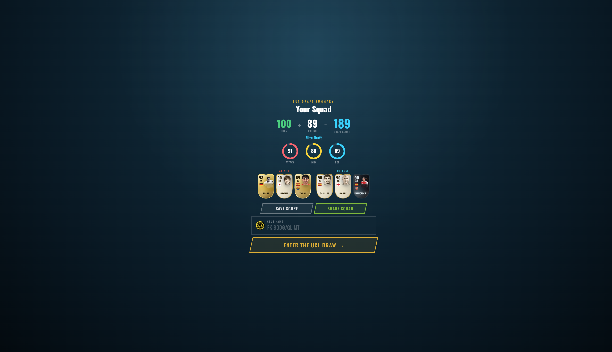
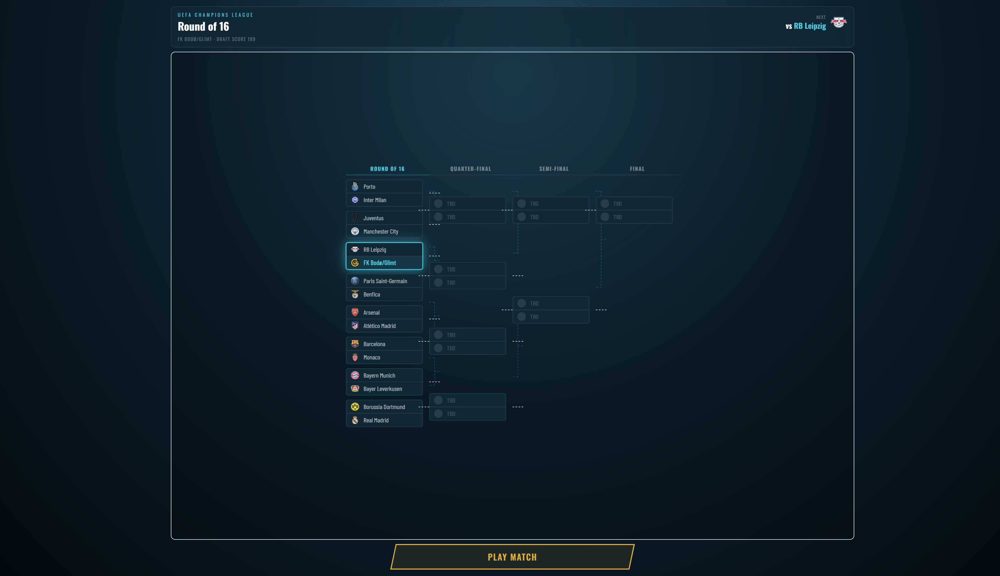
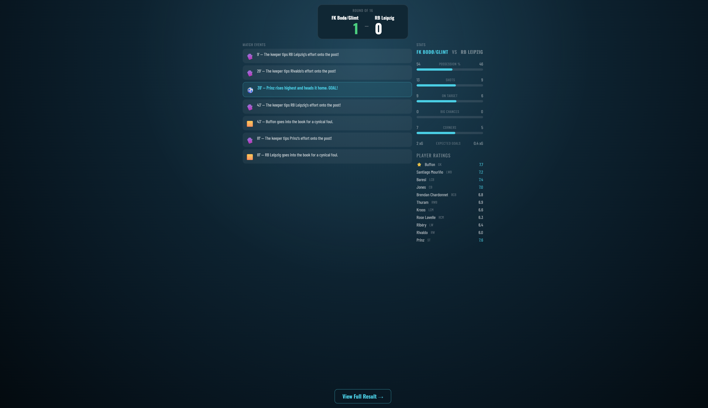
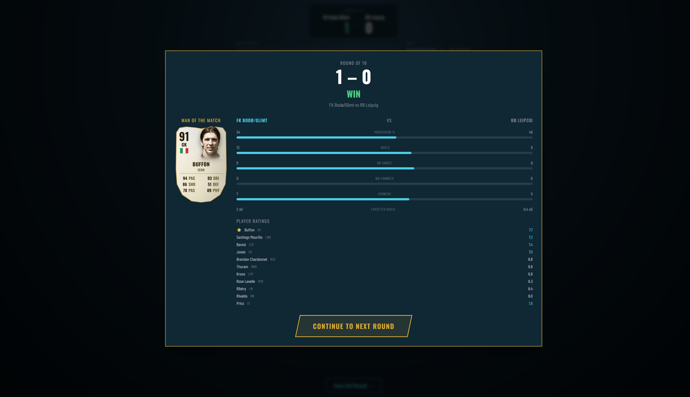

# FUT Draft / UCL Draft — Visual Handoff Brief

**Live:** https://ucl-draft-lemon.vercel.app  
**Stack:** Next.js 14, React 18, TypeScript, Tailwind, Vitest, Vercel, Upstash Redis  
**Screenshots:** `docs/screenshots/` (captured from production Sep 2026)

---

## Screenshots (walk the product)

### 01 — Landing

Dark stadium mesh, gold **DRAFT** hero, EA-skew **Start Draft** / **Leaderboard**, How to play. Mute top-right. First visit opens rules modal (dismissed here).

### 02 — Formation pick

Five formation options + live pitch preview. Breadcrumb + progress chrome. Select locks formation and starts draft.

### 03 — Draft pick banner (captain)

Full-width gold-bordered pick band over **blurred** pitch. Five cards (gold / hero / icon / TOTW mix). Left vertical **Squad** tab; right **Quick Sim**.

### 04 — Squad peek (hover/tap Squad)

Picks hide; empty pitch + bench visible; hint “Release Squad to pick.” (Scrim still slightly dims board — improvement target.)

### 05 — Final squad review

Full XI on pitch with green/yellow chem lines, 12-slot bench, Save/Share, side **Submit**. Manager name in header.

### 06 — Draft score summary

Chem + Rating = Draft Score + tier. ATT/MID/DEF rings, top cards, club name (default Bodø/Glimt), Enter UCL Draw.

### 07 — UCL bracket

16-team tree (R16→Final), user match highlighted, Play Match. Scales to fit (no horizontal scroll).

### 08 — Match sim

Scoreboard + event feed + possession/shots/xG + player ratings. Narrative sim, not playable 11v11.

### 09 — Post-match modal

Score, WIN/LOSS, MOTM card, comparative bars, ratings list, Continue.

---

## What it is

Browser **FIFA FUT Draft–style** game: formation → 23-man draft (11+7+5) via 5-card packs → manager → draft score → **UCL knockout** sim → share / leaderboard.

Visual language: stadium-at-night, gold/teal EA metro chrome, Oswald + Barlow Condensed, shield cards.

---

## Full flow

| # | State | Screen | Job |
|---|--------|--------|-----|
| 1 | LANDING | LandingScreen | Start / LB / rules |
| 2 | FORMATION_PICK | FormationScreen | Pick 1 of 5 |
| 3 | DRAFT | DraftScreen | Captain → fill 23; Quick Sim |
| 4 | MANAGER_PICK | ManagerScreen | 5 managers + chem boost |
| 5 | SQUAD_REVIEW | DraftScreen review | Rearrange, Share, Submit |
| 6 | DRAFT_SCORE | DraftScoreScreen | Score + name + enter draw |
| 7 | BRACKET_VIEW | BracketScreen | Tree + Play Match |
| 8 | MATCH_SIM / POST_MATCH | MatchScreen | Events → modal |
| 9 | TROPHY_SCREEN | TrophyScreen | Champ/out, share, LB, replay |

Share: `/?s=` opens SquadViewer.

---

## Systems (short)

- **Pool:** ~5250 players + specials + legends; display names mapped  
- **Packs:** position bands + league/nation affinity; specials taper `base×0.5^n`  
- **Bench:** FIFA sub order GK→DEF→MID→ATT; 5 reserve wildcards  
- **Chem:** FUT-16-ish links; loyalty always +1; manager nation/league +1; score = rating + chem  
- **Tournament:** user + 15 UCL clubs; xG sim; ET/pens  
- **Meta:** share URL, Web Share, Redis LB (or localStorage), mute, rules seen  
- **Gap:** no mid-draft resume (refresh loses run)

Key files: `src/hooks/useDraft.ts`, `src/engine/{chemistryEngine,playerUtils,bracketEngine,matchSimulator}.ts`, `src/screens/DraftScreen.tsx`, `src/app/globals.css`

---

## Gaps vs FIFA 15/16 FUT Draft

1. No coins / entry / rewards  
2. Custom affinity packs ≠ classic bronze/silver/gold tables  
3. Modern FC specials + FUT-16 legends era mashup  
4. UCL AI clubs, not Draft house opponents  
5. Match is narrative sim only  
6. No save/resume  
7. Loyalty always on  
8. Formation locked after pick  
9. Captain auto-slotted  
10. No chem styles / consumables / tactics  
11. Bodø/Glimt default crest (meme)  
12. Chem maps curated, not EA binaries  

---

## Improvement backlog (priority)

1. Mid-draft sessionStorage resume  
2. Commit/push so git = prod  
3. Daily seeded draft for fair LB  
4. Pack rarity closer to classic FUT  
5. Stronger FIFA-16 menu SFX / pack peel / card backs  
6. Match presentation more cinematic  
7. Prefetch images / bake `apply-names` into pipeline  
8. Confirm Upstash on Vercel for global LB  

---

## Questions for the next Claude

1. Target era: exact FIFA 15/16 fidelity, or FUT spirit + modern cards?  
2. Keep UCL tournament or classic Draft tournament structure?  
3. Match: stay sim, or invest in cinematic presentation only?  
4. Fake coin economy for authenticity?  
5. Captain: auto-slot OK or player places captain?  
6. Specials: taper, hard caps, or classic rarity tables?  
7. Keep Bodø branding or neutral Draft kit?  
8. First: resume, daily seed, or LB?  
9. Mobile-first vs desktop monitor UX?  
10. Art: FIFA 16 flat gold menus vs current stadium neon?  
11. Chem: current maps OK or research exact FUT15→16 link removals?  
12. Custom OG per shared squad worth it?  
13. Auth / multiplayer out of scope?  
14. Success metric: feel, share rate, completion, LB?  
15. Next: commit + CI from main, or keep CLI deploys?

---

## One-liner for the next Claude

> You’re improving a Next.js FUT Draft web game (https://ucl-draft-lemon.vercel.app). See `docs/screenshots/` for UI. Loop: formation → 23-man draft + chemistry pitch → manager → draft score → UCL knockout sim → share/LB. Recent UI: full viewport shell, blur + full-width pick banner, Squad hover peek (not mini-window). Gaps vs FIFA 15/16 Draft listed above. Ask clarifying questions on era fidelity, then propose a prioritized backlog without rewriting the engine blindly.
